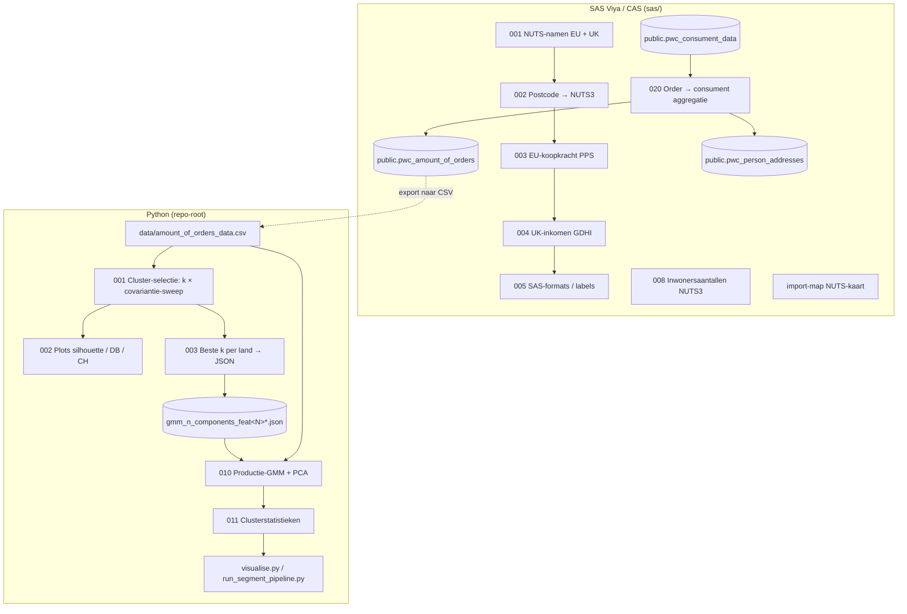

# Brabantia Customer Validation — consumentsegmentatie

Dit project deelt Brabantia-webshopconsumenten per land in segmenten in. Dat gebeurt met een
**Gaussian Mixture Model (GMM)** op PCA-gereduceerde aankoopkenmerken. Het project bestaat uit twee delen:

1. **SAS-voorbewerking** (`sas/`, draait op SAS Viya / CAS). Postcodes worden gekoppeld aan
   NUTS3-regio's, die regio's worden verrijkt met koopkracht en inwonersaantallen, en orderregels
   worden per consument samengevoegd tot één rij.
2. **Python-pipeline** (repo-root). Eerst bepaalt die hoeveel segmenten per land het beste
   werken. Daarna fit hij het definitieve GMM, maakt een PCA-rapportage en berekent
   clusterstatistieken en figuren.

Landen in scope: **NL, BE, FR, DE, GB (VK), ES**.

---

## Inhoudsopgave

1. [Overzicht van de dataflow](#overzicht-van-de-dataflow)
2. [Snelstart](#snelstart)
3. [Vereisten](#vereisten)
4. [Bestandsstructuur](#bestandsstructuur)
5. [Deel 1 — SAS-voorbewerking](#deel-1--sas-voorbewerking)
6. [Inputdata voor de Python-pipeline](#inputdata-voor-de-python-pipeline)
7. [Deel 2 — Python-pipeline](#deel-2--python-pipeline)
8. [Feature-sets (12 / 30 / 32)](#feature-sets-12--30--32)
9. [Extra modi: `--combine-countries` en `--recluster`](#extra-modi---combine-countries-en---recluster)
10. [Configuratie (`config.py`)](#configuratie-configpy)
11. [Outputbestanden](#outputbestanden)
12. [Logging](#logging)
13. [Methodologische keuzes](#methodologische-keuzes)
14. [Pipeline uitbreiden](#pipeline-uitbreiden)

---

## Overzicht van de dataflow



---

## Snelstart

1. **Voorbereiden.** Installeer de afhankelijkheden uit `requirements.txt` (zie
   [Vereisten](#vereisten)). Zet de export van de CAS-tabel `public.pwc_amount_of_orders` in
   `data/amount_of_orders_data.csv` en maak de outputmap `results/zonder_service/` aan.
2. **Fase 1 — verkennen.** Draai `run_cluster_selection.py`. Dat voert achter elkaar `001` (sweep
   over k en covariantie-types per land), `002` (plots) en `003` (beste configuratie per land
   naar JSON) uit. Wil je meerdere feature-sets na elkaar verkennen, gebruik dan
   `run_feature_sweep.py`.
3. **Controleren.** Bekijk de plots in `figures/` en de gegenereerde `gmm_n_components_feat<N>.json`.
   Pas de gekozen k per land zo nodig handmatig aan.
4. **Fase 2 — productie.** Draai `run_pipeline.py` met de gewenste feature-set (`--feature-set 12`,
   `30` of `32`). Dat voert `010` (GMM + PCA-rapport) en `011` (clusterstatistieken) uit. Zonder
   `--feature-set` worden alle drie de feature-sets na elkaar gedraaid.
5. **Rapporteren.** Maak met `visualise.py` een dashboardfiguur per land. Geef met `--input` het
   stats-bestand uit `results/zonder_service/` op.

---

## Vereisten

### Python

- **Python 3.10+**, vanwege type hints als `str | Path` en `dict[str, int]`.
- Installeer de afhankelijkheden uit `requirements.txt`, het liefst in een virtuele omgeving:

  ```bash
  python -m venv .venv
  source .venv/bin/activate        # Windows: .venv\Scripts\activate
  pip install -r requirements.txt
  ```

- Belangrijkste packages:

  | Package | Gebruikt voor |
  |---|---|
  | `pandas`, `numpy` | Data-inleesstap, aggregatie |
  | `scikit-learn` | `StandardScaler`, `PCA`, silhouette / Davies-Bouldin / Calinski-Harabasz |
  | `torch` | Tensors voor de GMM-fit |
  | `tgmm` | `GaussianMixture` en `ClusteringMetrics` (BIC/AIC), op PyTorch gebaseerd |
  | `matplotlib` | Alle figuren |

  `tgmm` levert ook de covariantie-types `tied_full`, `tied_diag` en `tied_spherical`. Die bestaan
  niet in de GMM van scikit-learn, dus deze pipeline werkt niet met `sklearn.mixture`.

### SAS

- SAS Viya met een actieve **CAS-sessie** en schrijfrechten op caslib `public`.
- Toegang tot `/sasdata/groups/PWC_Intern_SSBI/data/` (scripts 001–005) en
  `/sasdata/pwc/data/` (script 008 en `import-map.sas`).
- Libref `STAT` → `/sasdata/groups/PWC_Intern_SSBI/data/STAT`, formatlibrary
  `pwcfmt` → `/sasdata/groups/PWC_Intern_SSBI/data/format_library`.

---

## Bestandsstructuur

```
brabantia-customer-validation/
├── requirements.txt                            # Python-afhankelijkheden (pip install -r requirements.txt)
├── config.py                                   # Centrale instellingen: paden, landen, feature-sets, GMM-parameters
├── data_loading.py                             # load_and_clean() + prepare_features(), gedeeld door 001 en 010
├── logging_utils.py                            # get_logger(): stdout + één logbestand per proces
│
├── 001-cluster-selection-pipeline.py           # Fase 1: sweep k=3..6 × 6 covariantie-types per land, + PCA
├── 002-visualise-cluster-selection-pipeline.py # Fase 1: plot silhouette / Davies-Bouldin / Calinski-Harabasz vs. k
├── 003-update-config-from-cluster-selection.py # Fase 1: beste k + covariantie + init per land → JSON
├── 010-gmm-pipeline.py                         # Fase 2: productie-GMM + PCA-rapport per land
├── 011-stats-pipeline.py                       # Fase 2: clusterstatistieken per land
│
├── run_cluster_selection.py                    # Orchestrator fase 1
├── run_pipeline.py                             # Orchestrator fase 2 (één of alle feature-sets)
├── run_feature_sweep.py                        # Draait run_cluster_selection.py per feature-set
├── run_segment_pipeline.py                     # Segmentoverzicht: tabellen + staafdiagrammen uit stats-CSV
├── visualise.py                                # Dashboard-figuur (3×3) per land uit stats-CSV
│
├── sas/                                        # Voorbewerking op SAS Viya / CAS
│   ├── 001-Merge-EU-UK.sas                     # NUTS3-namen EU (5 landen) + UK samenvoegen
│   ├── 002-Combineer-NUTS-ZipCodes.sas         # Postcode → NUTS3-koppeltabel voor alle 6 landen
│   ├── 003-Toevoegen-EU-Inkomen.sas            # Koopkracht (PPS 2023) per NUTS3 voor EU-landen
│   ├── 004-Toevoegen-UK-Inkomen.sas            # GDHI per hoofd 2023 (ITL3 → NUTS3) voor het VK
│   ├── 005-Toevoegen-Labels.sas                # SAS-formats nuts3_fmt + country_fmt, gepromoot naar CAS
│   ├── 008-inwoners-aantallen.sas              # Inwonersaantallen per NUTS3 → public.pwc_inwoners_aantallen
│   ├── 010-import_naar_cas.sas                 # Inhoudelijk identiek aan 004
│   ├── 020-order-naar-consument-aggregatie.sas # Orderregels → één rij per consument
│   ├── import-map.sas                          # NUTS-kaartgeometrie → public.PWC_MAP_NUTS
│   ├── stat-import-flw.flw                     # Roept alle STAT verwerking aan
│   ├── run-full-pipeline.flw                   # Roept 010 en 020 aan.
│   └── import-clusters.flw                     # Importeert de clusters voor visualisatie in het dashboard
│
└── data/
    ├── amount_of_orders_data.csv               # Input Python-pipeline — NIET in git (zie .gitignore)
    └── regionale-statistieken/                 # Brondata voor de SAS-voorbewerking
        ├── pc2020_{BE,DE,ES,FR,NL,UK}_NUTS-2021_*.csv   # Eurostat postcode → NUTS3 (';'-gescheiden)
        ├── pc2018_uk_NUTS-2016_v3.0.csv                 # Oudere UK-koppeltabel (niet gebruikt in scripts)
        ├── NUTS2021-NUTS2024.xlsx                       # NUTS-codes en -namen EU
        ├── UK-NUTS.xlsx                                 # NUTS3-codes en -namen VK
        ├── EU_PPS_2023.xlsx                             # Koopkracht per NUTS3 (EU)
        ├── UK_inkomen_2023.xlsx                         # GDHI per hoofd per ITL-regio (VK)
        ├── UK.csv                                       # GDHI-tijdreeks per Local Authority (niet gebruikt in scripts)
        ├── inwoners-aantallen-nuts3-5eu-landen.xlsx     # Bevolking per NUTS3 (EU)
        └── inwoners-aantallen-nuts3-UK-2019.xlsx        # Bevolking per NUTS3 (VK)
```

Gegenereerde mappen worden niet gecommit (zie `.gitignore`): `results/`, `logs/`,
`figures*/`, `segment_overview*/` en `gmm_n_components_*.json`.

**Waarom de bestandsnamen met cijfers beginnen:** de nummers geven de logische volgorde aan.
Een bestand als `010-gmm-pipeline.py` kun je niet met `import` laden, dus de orchestrators
laden de stappen via `importlib` op basis van hun bestandspad (`_load_stage()`).

---

## Deel 1 — SAS-voorbewerking

De SAS-scripts bouwen eerst een regionale referentietabel (postcode → NUTS3 → koopkracht).
Daarna aggregeren ze orderdata tot consumentniveau.

| Script | Input | Output | Wat het doet |
|---|---|---|---|
| `001-Merge-EU-UK.sas` | `NUTS2021-NUTS2024.xlsx`, `UK-NUTS.xlsx` | `STAT.NUTS3_Names` | Neemt NUTS-code 2021 + label voor NL/DE/ES/FR/BE, voegt de UK-NUTS3-lijst toe (`country_code='UK'`). |
| `002-Combineer-NUTS-ZipCodes.sas` | `pc2020_*_NUTS-2021_*.csv` (6×) | `STAT.NUTS_ZIP_NAME` | Importeert de Eurostat-postcodetabellen, stapelt ze, verwijdert spaties uit postcodes en koppelt de NUTS3-namen eraan. |
| `003-Toevoegen-EU-Inkomen.sas` | `EU_PPS_2023.xlsx` | `STAT.EU_PPS`, `STAT.NUTS_ZIP_NAME` | Voegt koopkracht (PPS) per NUTS3 toe. Hercodeert NUTS-2024-codes voor NL en DE (o.a. `NL115→NL113`, `DEG0S→DEG04`) terug naar NUTS 2021, zodat ze op de postcodetabel aansluiten. |
| `004-Toevoegen-UK-Inkomen.sas` | `UK_inkomen_2023.xlsx` (tab `GDHI-Head`) | `STAT.UK_Inkomen`, `STAT.NUTS_ZIP_NAME` | Neemt het besteedbaar inkomen per hoofd (2023) op ITL3-niveau en vertaalt ITL-codes naar NUTS3 (`TLx..` → `UKx..`, met handmatige mapping waar regio's zijn gesplitst of samengevoegd). Overschrijft `Koopkracht` met dit inkomen voor UK-regio's. |
| `005-Toevoegen-Labels.sas` | `STAT.NUTS_ZIP_NAME` | formatlibrary `pwcfmt` (CAS, global) | Maakt format `$nuts3_fmt.` (NUTS3-code → regionaam) en `$country_fmt.` (landcode → Nederlandse landnaam) en promoot de library naar CAS. |
| `008-inwoners-aantallen.sas` | `inwoners-aantallen-nuts3-*.xlsx` | `public.pwc_inwoners_aantallen` | Bevolking per NUTS3 (totaal, <15, 15–64, 65+). Voor EU-regio's zonder 2024-cijfer wordt 2021 gebruikt. |
| `import-map.sas` | `/sasdata/pwc/data/map/table_MAP_EU_NUTS.csv` | `public.PWC_MAP_NUTS` | Kaartgeometrie voor visualisaties in SAS Visual Analytics. |
| `020-order-naar-consument-aggregatie.sas` | `public.pwc_consument_data` | `public.pwc_amount_of_orders`, `public.pwc_person_addresses` | Zie hieronder. |

Volgorde: `001 → 002 → 003 → 004 → 005`. `008` en `import-map` staan los daarvan, en `020` draait als `pwc_consument_data` beschikbaar is.

### `020-order-naar-consument-aggregatie.sas`

Dit script maakt van orderregels de consumenttabel waarop het model draait (`GROUP BY master_person_key_md5`):

- **Stap 1 — aggregatie (`pwc_aggregated`):** sommen van producten, orderline sales, het aantal orders
  (`order_number_functional_count`), omzet per productcategorie (`waste_management`, `bathroom_toilet`,
  `food_enjoyment`, `laundry_caring`, `service`, `other`), jaartotalen 2024/2025 en 18
  campagne- en seizoenskolommen. `net_sales` is het gemiddelde van `net_sales`; is dat 0 of leeg, dan
  wordt de som van `orderline_sales` gebruikt. `koopkracht` en `gender_encoded` zijn gemiddelden.
- **Stap 2 — concatenatie (`pwc_concatenated`):** ordernummers, producten, attributen en
  categorieën per consument, `|`-gescheiden, plus `prd_country`.
- **Stap 3 — join** van stap 1 en 2 → `public.pwc_amount_of_orders`.
- **Stap 4 — adrestabel** `public.pwc_person_addresses` (geslacht, geboortedatum, postcode, NUTS3,
  koopkracht, …), unieke rijen per consument.
- **Stap 5/6:** promoveert de eindtabellen en ruimt tussentabellen op.
- Aan het eind staan enkele verkennende queries (outliers met >100 producten of `net_sales > 10.000`)
  en een `proc freq`.

> De tabel `public.pwc_consument_data` (orderregels verrijkt met NUTS3 en koopkracht) wordt **niet**
> in deze repo aangemaakt. Waarschijnlijk gebeurt dat in een van de SAS Studio flows (`*.flw`),
> maar die zijn in de repo leeg.

---

## Inputdata voor de Python-pipeline

De Python-pipeline leest **`data/amount_of_orders_data.csv`** (`config.GMM_INPUT_PATH`). Dit is
een CSV-export van `public.pwc_amount_of_orders`. Het bestand staat bewust niet in git
(`.gitignore`: `amount_*`), omdat het persoonsgebonden klantdata bevat.

Verwachte kolommen (namen in hoofdletters, zoals in `config.py`):

| Kolom | Type | Rol |
|---|---|---|
| `master_person_key_md5` | string | Unieke consument-ID (`config.ID_COL`), niet in het model |
| `prd_country` | string | Land (`config.COUNTRY_COL`): `NL`, `BE`, `FR`, `DE`, `GB`, `ES` |
| `TOTAL_PRODUCTS_IN_ORDER`, `TOTAL_ORDERLINE_SALES`, `ORDER_NUMBER_FUNCTIONAL_COUNT`, `NET_SALES` | numeriek | Aankoopgedrag |
| `TOTAL_BATHROOM_TOILET`, `TOTAL_FOOD_ENJOYMENT`, `TOTAL_WASTE_MANAGEMENT`, `TOTAL_LAUNDRY_CARING`, `TOTAL_OTHERS` | numeriek | Omzet per productcategorie |
| `TOTAL_SERVICE` | numeriek | Servicecategorie, in **alle** feature-sets uitgesloten ("zonder service") |
| `TOTAL_2024`, `TOTAL_2025` | numeriek | Jaartotalen |
| 18× `TOTAL_<campagne/seizoen>` | numeriek | Bijv. `TOTAL_OUTLET_JAN_2024`, `TOTAL_SPRING_SALES`, `TOTAL_PRE_HOLIDAY` |
| `KOOPKRACHT` | numeriek (als tekst geëxporteerd) | Regionale koopkracht; wordt in `load_and_clean()` naar numeriek omgezet |
| `GENDER_ENCODED` | numeriek | Gecodeerd geslacht |
| `ORDER_NUMBER_FUNCTIONAL_ALL`, `ALL_*_ALL` | string | Concatenaties, worden als niet-numeriek automatisch genegeerd |

**Let op de landcode:** de Python-pipeline gebruikt `GB` voor het Verenigd Koninkrijk. In de
SAS-referentietabellen staat `country_code = 'UK'`. `prd_country` in de brondata moet dus `GB` zijn.

---

## Deel 2 — Python-pipeline

### Gedeelde modules

**`data_loading.py`** zorgt dat 001 en 010 exact dezelfde featurematrix gebruiken:

- `load_and_clean(pad, country_specific_recluster=None)` leest de CSV in, zet `KOOPKRACHT` om naar
  numeriek en vult ontbrekende numerieke waarden met de **mediaan per land**
  (`groupby(prd_country).transform(median)`). Niet-numerieke ontbrekende waarden blijven staan en
  geven een waarschuwing. Met `country_specific_recluster` filtert de functie op één segment per land
  (zie [`--recluster`](#--recluster-experimenteel)).
- `prepare_features(df_land)` verwijdert de ID, het land, alle niet-numerieke kolommen, de kolommen
  in `GMM_EXTRA_EXCLUDE_COLS` van de actieve feature-set en alles met `segment` in de naam.

**`logging_utils.py`** geeft via `get_logger(naam)` een logger die naar stdout én naar
`logs/run_<YYYYmmdd_HHMMSS>.log` schrijft (zie [Logging](#logging)).

### Fase 1 — Hoeveel segmenten per land?

#### `001-cluster-selection-pipeline.py`

Voor elk covariantie-type in `config.COVARIANCE_TYPE`
(`full`, `diag`, `spherical`, `tied_full`, `tied_diag`, `tied_spherical`) en elk land:

1. `prepare_features()`, daarna `StandardScaler` (per land gefit).
2. PCA op de geschaalde features. Met `PCA_N_COMPONENTS ≥ 1` (standaard `12`) worden **alle**
   componenten behouden, wat neerkomt op een decorrelerende rotatie. Een waarde `< 1` wordt
   gelezen als drempel voor de verklaarde variantie.
3. Voor `k = 3 … 6`: een `tgmm.GaussianMixture` (k-means-initialisatie, `n_init=5`,
   `reg_covar=1e-4`, `random_state=0`) op de PCA-scores, gescoord met:
   - **silhouette** (hoger is beter; berekend op een steekproef van max. 5000 rijen),
   - **Davies-Bouldin** (lager is beter),
   - **Calinski-Harabasz** (hoger is beter),
   - **BIC / AIC** via `tgmm.ClusteringMetrics`, als het model `lower_bound_` heeft,
   - `best_init_setup`: de random state van de beste herstart, zodat 010 die fit exact kan reproduceren.
4. Mislukte fits (bijv. singuliere covarianties) worden gelogd en overgeslagen.

Output: `results/zonder_service/cluster_selection_feat<N>_<timestamp>.csv`, plus
`pca_scores_feat<N>.csv` en `pca_loadings_feat<N>.csv` (om features te vinden die weinig bijdragen).
Aan het eind logt het script per land de k met de hoogste silhouette-score.

#### `002-visualise-cluster-selection-pipeline.py`

Maakt per land één figuur met drie subplots (silhouette, Davies-Bouldin en Calinski-Harabasz tegen
k), met één lijn per covariantie-type.

```bash
python 002-visualise-cluster-selection-pipeline.py --visualise-path <cluster_selection-csv>
python 002-visualise-cluster-selection-pipeline.py --combine-countries --visualise-path <csv>
```

Output: `figures/cluster_selection_<land>_feat<N>.png`.

#### `003-update-config-from-cluster-selection.py`

Zoekt `./results/cluster_selection_*.csv`, groepeert op feature-tag (`feat12`, …) en neemt per
tag het nieuwste bestand. Per land kiest het de rij met de **hoogste silhouette** (bij gelijke stand:
laagste Davies-Bouldin) en schrijft die weg:

```json
{
    "NL": { "n_clusters": 4, "best_init_setup": 3, "covariance_type": "full" },
    "BE": { "n_clusters": 3, "best_init_setup": 1, "covariance_type": "diag" }
}
```

naar `gmm_n_components_feat<N>.json` (of `gmm_n_components_combined_feat<N>.json` met
`--combine-countries`).

> **Controleer dit bestand altijd.** De keuze op silhouette is een hulpmiddel en geen eindoordeel.
> Een iets lagere k met beter uitlegbare segmenten is voor de business vaak beter. Pas de JSON
> desgewenst handmatig aan.

### Fase 2 — Productie

#### `010-gmm-pipeline.py`

Per land (of per gepoolde groep, zie `--combine-countries`):

1. Leest `n_clusters`, `covariance_type` en `best_init_setup` uit de config-JSON via
   `config.get_n_components()`, `get_covariance_type()` en `get_best_init_setup()`. Ontbreekt een land,
   dan valt de stap terug op `6` / `full` / `0` en geeft een waarschuwing.
2. Dezelfde voorbewerking als 001: `prepare_features` → `StandardScaler` → PCA.
3. GMM-fit op de PCA-scores. Elke rij krijgt `segment` (hard label) en `segment_<i>_kans`
   (posterior-kans per component).
4. Schrijft één CSV per land en één gecombineerde CSV met `segment_globaal = <land>_<segment>`
   (segmentnummers zijn alleen uniek binnen een land).
5. **PCA-rapport:** dit is dezelfde PCA-fit als die voor clustering is gebruikt (vroeger stap 030),
   zodat het rapport altijd past bij de ruimte waarin de segmenten liggen. Het script schrijft de
   PCA-scores naar CSV en een leesbaar `.txt`-rapport met verklaarde variantie (per component en
   cumulatief), singular values, loadings en de top 10 features per component.

#### `011-stats-pipeline.py`

Leest de per-land-CSV's van 010 en berekent per segment:

- `n_points` en `pct_of_total`,
- per numerieke feature: `count`, `mean`, `std`, `min`, `median`, `max` (kolommen `<feature>_<stat>`),
- per-cluster silhouette: `silhouette_mean/std/min/max`,
- overall `silhouette_score`, `calinski_harabasz_score` en `davies_bouldin_score` (als
  `overall_*`, herhaald op elke rij).

De silhouette wordt hier op de geschaalde ruwe features berekend en **niet** op een steekproef.
Bij grote landen kan dit lang duren en veel geheugen kosten (de kosten groeien kwadratisch met het
aantal rijen).

Output: `results/zonder_service/stats_<FEATURE_SET>_<timestamp>.csv`, één rij per (land, segment).

### Rapportage

#### `visualise.py`

Maakt per land een dashboard van 3×3 panelen: klanten per segment, gemiddelde net- vs.
orderline-sales, koopkracht, een radar van uitgaven per categorie, producten per order, orders per
klant, silhouette per cluster, de kwaliteitsmetrics en (als aanwezig) uitgaven in 2024 vs. 2025.

```bash
python visualise.py --input results/zonder_service/stats_12_<timestamp>.csv --output figures/
```

#### `run_segment_pipeline.py`

Maakt per land segmentgroottes, een vergelijking van kernmetrics en een vergelijking van
categorieën (CSV + PNG) in `segment_overview/<land>/`. De kolommen komen uit
`config.GMM_FEATURE_COLS`.

---

## Feature-sets (12 / 30 / 32)

De omgevingsvariabele `FEATURE_SET` bepaalt bij het importeren van `config.py` welke kolommen in het
model gaan. Alle outputbestanden en de config-JSON krijgen die tag.

| `FEATURE_SET` | Uitgesloten (naast ID, land, tekstkolommen) | Resterende numerieke features* |
|---|---|---|
| `12` | `TOTAL_SERVICE`, `TOTAL_2024`, `TOTAL_2025`, alle 18 campagne/seizoenskolommen | 11 |
| `30` | `TOTAL_SERVICE`, `TOTAL_2024`, `TOTAL_2025` | 29 |
| `32` | `TOTAL_SERVICE` | 31 |

\* De namen `12/30/32` stammen uit de tijd dat `TOTAL_SERVICE` nog meedeed. Die kolom wordt nu in
alle varianten uitgesloten (de "zonder service"-run), dus elk feature-set heeft één feature minder
dan de naam zegt. Het precieze aantal staat in de log (`Features: [...]`) en in het PCA-rapport.

```bash
FEATURE_SET=30 python 001-cluster-selection-pipeline.py
python run_pipeline.py --feature-set 30
python run_pipeline.py                    # zonder argument: 12, 30 en 32 achter elkaar, elk in een eigen subproces
```

Elke feature-set draait in een **apart proces**, omdat `config.py` alle afgeleide paden en
kolomlijsten één keer bij het importeren vastlegt. `os.environ` aanpassen nadat `config` al is
geïmporteerd heeft geen effect.

`run_feature_sweep.py` doorloopt de lijst `FEATURE_SETS`. Die staat nu op alleen `["32"]`
(12 en 30 zijn uitgecommentarieerd).

---

## Extra modi: `--combine-countries` en `--recluster`

### `--combine-countries`

Hiermee worden alle landen samengevoegd tot **één** PCA en één GMM, zodat de segmenten over landen
heen vergelijkbaar zijn. De groep krijgt het label `"+".join(sorted(LANDEN))`, bijvoorbeeld
`BE+DE+ES+FR+GB+NL`.

- 001 en 002 maken één sweep en één plot voor die groep. 001 bewaart het oorspronkelijke land in de
  PCA-scores.
- 003 schrijft `gmm_n_components_combined_feat<N>.json`.
- 010 zoekt de configuratie op onder het samengestelde label, fit één model en splitst de uitkomst
  daarna weer per land voor de output.
- 011 verwacht met deze vlag een `config.STATS_COMBINED_OUTPUT`.

### `--recluster` (experimenteel)

Dit is bedoeld om het **grootste segment per land** opnieuw te clusteren in subsegmenten:

```bash
python run_pipeline.py --feature-set 12 --recluster \
    --recluster-path results/zonder_service/clusters_12_<timestamp>.csv
```

De code zoekt het bijbehorende stats-bestand (`clusters` → `stats` in de bestandsnaam, gezocht in
`results/`), bepaalt per land het segment met de meeste `n_points`, filtert de data op dat segment
en clustert opnieuw. De output gaat naar `results/zonder_service/recluster/`. Deze modus heeft nog
een paar losse eindjes (zie hieronder) en is niet volledig getest.

---

## Configuratie (`config.py`)

Alle instellingen staan in één bestand. Elke stap importeert ze van daar.

| Instelling | Standaard | Betekenis |
|---|---|---|
| `LANDEN` | `["NL","BE","FR","DE","GB","ES"]` | Landen die elke stap verwerkt |
| `FEATURE_SET` | env var, standaard `"12"` | Actieve feature-variant (`12`/`30`/`32`) |
| `FEATURE_TAG` | `feat<FEATURE_SET>` | Tag in bestandsnamen |
| `ID_COL` / `COUNTRY_COL` / `LAND_COL` | `master_person_key_md5` / `prd_country` / `land` | Kolomnamen |
| `EXCLUDE_TERMS` | `["segment"]` | Kolommen met deze tekst gaan nooit het model in |
| `GMM_EXTRA_EXCLUDE_COLS_VARIANTS` | zie [Feature-sets](#feature-sets-12--30--32) | Uitsluitlijst per feature-set |
| `GMM_FEATURE_COLS` | 11 kolommen | Gebruikt door `run_segment_pipeline.py` voor de rapportage |
| `GMM_CONFIG_PATH` | `gmm_n_components_<tag>_zonder_service.json` | Config-JSON die 010 inleest |
| `COVARIANCE_TYPE` | 6 types | Covariantie-types in de sweep van 001 |
| `CLUSTER_SELECTION_K_MIN` / `_K_MAX` | `3` / `6` | Bereik van k in fase 1 |
| `CLUSTER_SELECTION_N_INIT` | `5` | Herstarts per GMM-fit (wordt **ook** in 010 gebruikt) |
| `CLUSTER_SELECTION_SILHOUETTE_SAMPLE_SIZE` | `5000` | Steekproefgrootte voor silhouette in 001 (`None` = alles) |
| `CLUSTER_SELECTION_RANDOM_STATE` | `0` | Seed voor de sweep |
| `PCA_N_COMPONENTS` | `12` | `≥ 1` → alle componenten; `< 1` → drempel voor verklaarde variantie |
| `PCA_VARIANCE_TARGET` | `1` | Drempel voor "componenten nodig voor X% variantie" in het PCA-rapport |
| `PCA_TOP_N_FEATURES` | `10` | Aantal top-loadings per component in het rapport |
| `GMM_N_COMPONENTS_DEFAULT` | `6` | Terugvalwaarde als een land niet in de JSON staat |
| `GMM_INPUT_PATH` | `data/amount_of_orders_data.csv` | Inputbestand |

Bij het importeren maakt `config.py` alleen `data/`, `results/` en `figures/` aan. De submap
`results/zonder_service/` (en `.../recluster/`) moet je zelf aanmaken.

---

## Outputbestanden

`<ts>` is de timestamp op minuutniveau (`YYYY-MM-DD_HH-MM`). Die wordt **één keer** bepaald, op het
moment dat `config.py` wordt geïmporteerd.

| Bestand | Gemaakt door | Inhoud |
|---|---|---|
| `results/zonder_service/cluster_selection_feat<N>_<ts>.csv` | 001 | Scores per (covariantie, land, k), met `best_init_setup`, BIC en AIC |
| `results/zonder_service/pca_scores_feat<N>.csv` | 001 | PCA-scores per rij, land en covariantie-type |
| `results/zonder_service/pca_loadings_feat<N>.csv` | 001 | Loadings en verklaarde variantie per component |
| `figures/cluster_selection_<land>_feat<N>.png` | 002 | Drie metrics tegen k, één lijn per covariantie-type |
| `gmm_n_components_feat<N>.json` | 003 | Beste k, init en covariantie per land |
| `results/zonder_service/clusters_<N>_<ts>_<land>.csv` | 010 | Inputrijen + `segment` + `segment_<i>_kans` |
| `results/zonder_service/clusters_<N>_<ts>.csv` | 010 | Alle landen samen + `segment_globaal` |
| `results/zonder_service/consumers_met_pca_<N>_<ts>.csv` | 010 | ID + PCA-scores + segmentkolommen |
| `results/zonder_service/PCA_<N>_<ts>.txt` | 010 | Leesbaar PCA-rapport per land |
| `results/zonder_service/stats_<N>_<ts>.csv` | 011 | Statistieken per (land, segment) |
| `figures/stats_<land>.png` | `visualise.py` | Dashboard per land |
| `segment_overview/<land>/*.csv / *.png` | `run_segment_pipeline.py` | Segmentoverzichten |
| `logs/run_<YYYYmmdd_HHMMSS>.log` | elk proces | Alle logregels van één run |

---

## Logging

Elke stap gebruikt `logging_utils.get_logger(naam)`, met dit formaat:

```
09:04:12 | INFO    | 010-gmm | NL: PCA reduced 11 features to 11 components (100.0% variance explained).
```

Er komt één logbestand **per proces** in `logs/`. Draai je `run_pipeline.py`, dan staan de regels
van 010 en 011 in dezelfde file, op chronologische volgorde. Elk bestand begint met een header:

```
================================================================================
Run started : 2026-08-18 09:04:12
Entry point : run_pipeline.py
Command     : run_pipeline.py --feature-set 12
================================================================================
```

Meer detail, zoals de verdeling van ontbrekende waarden:

```python
import logging
logging.getLogger("data-loading").setLevel(logging.DEBUG)
```

---

## Methodologische keuzes

- **Segmentatie per land.** Scaler, PCA en GMM worden per land apart gefit. Zo vergelijk je
  consumenten binnen een land met elkaar, en niet landen onderling (Duitse koopkracht is
  bijvoorbeeld geen schaalverschuiving van Spaanse). Segment `2` in NL heeft dus niets met
  segment `2` in DE te maken. Gebruik `segment_globaal`.
- **Mediaan-imputatie per land** in plaats van globaal, om dezelfde reden.
- **GMM op PCA-scores.** Met alle componenten (`PCA_N_COMPONENTS ≥ 1`) verandert er niets aan de
  informatie. De componenten zijn alleen gedecorreleerd, wat de covariantieschatting stabieler
  maakt, vooral bij `full`-covarianties met 30+ features.
- **Reproduceerbaarheid via `best_init_setup`.** 001 slaat de random state van de beste herstart
  op en 010 hergebruikt die. Daardoor geeft de productie-fit dezelfde segmenten als het punt dat in
  de sweep is gekozen. Dat werkt alleen als data, feature-set en `n_init` gelijk zijn.
- **Zachte toewijzing beschikbaar.** De kolommen `segment_<i>_kans` laten zien hoe zeker de
  toewijzing is. Consumenten met een lage maximale kans liggen op de grens tussen segmenten.
- **Kwaliteitsmetrics zijn indicatief.** Silhouette, DB en CH gaan uit van min of meer bolvormige
  clusters, terwijl een GMM ook langgerekte clusters kan vinden. BIC/AIC passen beter bij een GMM.
  De interpretatie door de business blijft beslissend.

---

## Pipeline uitbreiden

- **Land toevoegen:** zet de code in `config.LANDEN` (in dezelfde vorm als in `prd_country`), voeg in
  SAS de postcode→NUTS3-tabel en de koopkrachtdata toe en draai fase 1 opnieuw.
- **Features aanpassen:** wijzig `GMM_EXTRA_EXCLUDE_COLS_VARIANTS` in `config.py`. Voeg zo nodig een
  nieuwe sleutel toe aan `_VALID_FEATURE_SETS` en aan `ALL_FEATURE_SETS` in `run_pipeline.py`.
  Nieuwe brondata-kolommen maak je in `sas/020-order-naar-consument-aggregatie.sas`.
- **Andere covariantie-types of k-bereik:** pas `COVARIANCE_TYPE` en `CLUSTER_SELECTION_K_MIN/MAX` aan.
  001 en 002 nemen dat automatisch over.
- **Extra metric in de sweep:** breid `_evaluate_k()` in 001 uit, voeg een kolomnaam-constante toe in
  `config.py`, voeg een subplot toe in 002 en pas zo nodig de selectieregel in 003 aan.
- **Eén stap los draaien:** elk genummerd script heeft een `if __name__ == "__main__":`-blok. Elke run
  krijgt een eigen timestamp, dus een los gedraaide stap vindt output van een eerdere run niet
  vanzelf.
